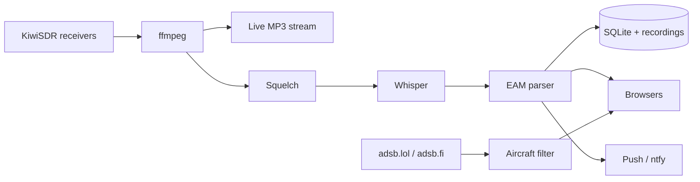

# Skywatch

[](https://github.com/zkm/skywatch/actions/workflows/ci.yml)
[](https://skywatch.zkm.tw)
[](LICENSE)


**Listen to the US Air Force's HF radio network and copy every Emergency Action Message as it's read.**

**[Listen live →](https://skywatch.zkm.tw)**


> EAMs are encrypted. Skywatch writes down the characters; it can't decode them.
> Everything it uses is public: shortwave radio and ADS-B.

## Features

- **Live audio** from 11175 kHz, with a signal meter.
- **Machine copy** of each EAM, character by character, from both on-air reads.
- **Crowd corrections:** click a character to hear it and vote. Agreed votes replace the `?`.
- **Copy trainer:** practise on real recordings.
- **Strategic aircraft** (E-6B, E-4B, B-52H, B-2, B-1B, RC-135, WC-135, VC-25A) on a map from public ADS-B.
- **Alerts:** browser push or [ntfy](https://ntfy.sh) for new EAMs, email when an E-4B appears.

## How it works



The squelch cuts out each transmission. Whisper transcribes it, and the parser
turns the phonetic words into characters. Anything uncertain becomes `?`.

## Quick start

Pick a few receivers from the [KiwiSDR map](http://kiwisdr.com/public/) with free
slots, no time limit and their own `host:port`. Skip `*.proxy.kiwisdr.com`
receivers; they drop the connection.

```sh
cp .env.example .env        # set KIWI_HOSTS=host:port,host:port
docker compose up --build   # open http://localhost:8000
```

Without Docker you need Python 3.11–3.14, ffmpeg and
[kiwiclient](https://github.com/jks-prv/kiwiclient):

```sh
python -m venv .venv && . .venv/bin/activate && pip install -r requirements.txt
export $(grep -v '^#' .env | xargs) KIWIRECORDER=/path/to/kiwiclient/kiwirecorder.py
uvicorn app.main:app --port 8000
```

## Configuration

Everything is set with environment variables. `.env.example` has a commented
starting point.

**Receiver**

| Variable | Default | |
|---|---|---|
| `KIWI_HOSTS` | | KiwiSDRs as `host:port`, comma-separated, tried in order and rotated on disconnect |
| `KIWI_USER` / `KIWI_PASSWORD` | `skywatch` / | Name shown on the Kiwi's user list; password for private receivers |
| `FREQ_KHZ` / `MODE` | `11175` / `usb` | |
| `PASSBAND_LO` / `PASSBAND_HI` | `300` / `2700` | Audio passband in Hz |
| `RECONNECT_BACKOFF` | `15` | Seconds to wait before trying the next receiver |
| `EAM_SOURCE` | `kiwi` | `file` replays `EAM_FILE` instead (any format ffmpeg reads); `EAM_FILE_LOOP=1` repeats it |

**Squelch and transcription**

| Variable | Default | |
|---|---|---|
| `SQUELCH_OPEN_DB` / `SQUELCH_CLOSE_DB` | `8` / `5` | dB above the tracked noise floor |
| `SQUELCH_HANG_S` | `3.0` | Silence allowed inside one transmission |
| `PREROLL_S` / `MIN_TX_S` / `MAX_TX_S` | `1.0` / `4` / `300` | Audio kept before opening; shortest and longest transmission |
| `ASR_BACKEND` | `whisper` | `none` skips transcription (useful for testing) |
| `WHISPER_MODEL` | `small.en` | `tiny.en` … `medium.en` |
| `WHISPER_DEVICE` / `WHISPER_COMPUTE` | `cpu` / `int8` | `cuda` if you have a GPU |
| `MIN_WORD_PROB` | `0.45` | Words Whisper is less sure of than this become `?` |
| `WHISPER_VAD` | `0` | `1` turns on Whisper's own voice detection. It tends to throw away HF voice as noise, and the squelch already cuts out each transmission |
| `KEEP_NON_EAM` | `1` | Also archive radio checks and other voice traffic |

**Listeners**

| Variable | Default | |
|---|---|---|
| `CORRECTION_MIN_VOTES` | `2` | Agreeing votes, with no tie, before a correction takes effect |
| `CORRECTION_RATE` | `120` | Votes per listener per hour |
| `PUSH_SUBJECT` | | Required for browser push: `mailto:you@example.com` or `https://your.host` (no path) |
| `PUSH_KINDS` | `eam` | What notifies: any of `eam`, `skyking`, `voice` |
| `NTFY_URL` | | Also post each message to an ntfy topic, e.g. `https://ntfy.sh/your-topic` |
| `ALERT_EMAIL_TO` | | Email these addresses (comma-separated) when an E-4B is first heard on ADS-B |
| `SMTP_HOST` / `SMTP_PORT` | / `587` | Mail server for those emails; STARTTLS on 587, implicit TLS on 465 |
| `SMTP_USER` / `SMTP_PASSWORD` / `SMTP_FROM` | | Login, and the sender address (defaults to `SMTP_USER`) |
| `ADSB_ENABLED` / `ADSB_URL` / `ADSB_POLL_S` | `1` / adsb.lol military feed, then adsb.fi's / `30` | Any ADSBExchange-v2-style feeds, comma-separated in order of preference; a failing feed backs off (doubling up to 15 min, longer if it sends `Retry-After`) while the next is used |

**Server**

| Variable | Default | |
|---|---|---|
| `DATA_DIR` | `./data` (`/data` in Docker) | Database, recordings, keys and the Whisper model |
| `LIVE_BITRATE` | `32k` | |
| `TRUST_PROXY` | `0` | Set to `1` behind a reverse proxy so listeners are told apart by `X-Forwarded-For` |
| `LOG_LEVEL` | `INFO` | |

## Deploying

- **HTTPS** is required for browser push. Behind a reverse proxy, set `TRUST_PROXY=1`.
- **Back up `DATA_DIR`.** `vapid_private.pem` and `voter.salt` can't be replaced
  without breaking push subscriptions and voting.
- **List several receivers** in `KIWI_HOSTS`; Skywatch moves to the next if one drops.
- **Size:** at least 2 GB RAM and 2 vCPUs for Whisper `small.en`.
- **Example:** [`deploy/`](deploy/) has the setup behind skywatch.zkm.tw
  (Docker Compose, Caddy, auto-deploy, backups).

## Development

```sh
python tools/make_test_audio.py test.wav                 # synthetic test audio
DATA_DIR=./data PYTHONPATH=. python tools/seed_demo.py    # sample messages
EAM_SOURCE=file EAM_FILE=test.wav ASR_BACKEND=none uvicorn app.main:app
python -m pytest -q
```

`EAM_SOURCE=file` also plays real recordings, the easiest way to tune the squelch.
`python tools/build_pages.py _site` builds a static demo with sample data.

Code: `app/` (server), `web/` (UI, no build step), `tests/`, `tools/`, `deploy/`.

## API

| Route | |
|---|---|
| `GET /live.mp3` | Live stream (silence-filled while the receiver is down) |
| `GET /api/status` | Receiver, level and floor dB, squelch, ASR queue, listeners |
| `GET /api/events` | SSE: `status` every 0.5 s, `transmission` (squelch closed, being transcribed), `message`, `correction`, `aircraft` |
| `GET /api/messages?kind=eam\|skyking\|voice\|all&limit=&before=` | Archive, newest first |
| `GET /api/messages/{id}` | Full record: per-character timestamps, both reads, ASR words, vote tallies |
| `POST /api/messages/{id}/corrections` | `{"pos": 0, "char": "A"}` (0-based position); re-voting replaces your vote |
| `GET /api/aircraft` | Watched aircraft with recent trails |
| `GET /api/push/key` | VAPID public key (503 when push is off) |
| `POST /api/push/subscribe` | Body: the browser's `PushSubscription.toJSON()` |
| `POST /api/push/unsubscribe` | `{"endpoint": "..."}` |
| `GET /audio/<file>.mp3` | An archived recording |

## Roadmap

- A Whisper model tuned on HF voice, to cut down the `?`s.

## Credits

- Receivers: [KiwiSDR](http://kiwisdr.com) and [kiwiclient](https://github.com/jks-prv/kiwiclient)
- Transcription: [faster-whisper](https://github.com/SYSTRAN/faster-whisper)
- Aircraft: [adsb.lol](https://adsb.lol), [adsb.fi](https://adsb.fi), [Leaflet](https://leafletjs.com),
  [OpenStreetMap](https://www.openstreetmap.org/copyright)
- Inspired by [missileer.watch](https://missileer.watch)

**Background reading:** [Priyom](https://priyom.org/military-stations/united-states/hfgcs) ·
[Number Stations Research](https://www.numbers-stations.com/usa/hfgcs/) ·
[NEET INTEL FAQ](https://neetintel.github.io/hfgcs_faq.html) ·
[Milcom Monitoring Post](https://mt-milcom.blogspot.com/p/what-is-emergency-action-message-or-eam.html) ·
[USAF Grand Forks](https://www.grandforks.af.mil/News/Display/Article/3415740/) ·
Ashton B. Carter, "The Command and Control of Nuclear War," *Scientific American*, January 1985

## License

[MIT](LICENSE). Security issues: [SECURITY.md](SECURITY.md).
