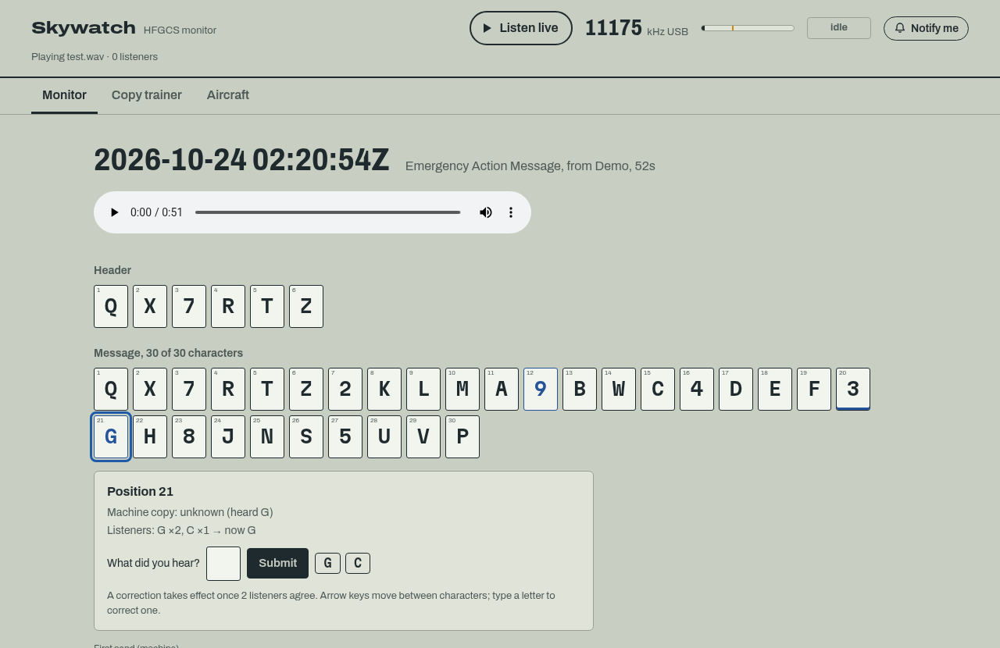

# Skywatch

**Listen to the US Air Force's HFGCS shortwave network, and copy every Emergency Action Message as it's broadcast.**

Skywatch tunes public KiwiSDR receivers to 11175 kHz, cuts out each
transmission, transcribes it with Whisper, and copies Emergency Action Messages
(EAMs) character by character. Listeners can hear any message again, fix the
characters the machine missed, practise copying for themselves, follow
strategic aircraft on public ADS-B, and get a notification when a new EAM
comes in.

**[Try the demo →](https://zkm.github.io/skywatch/)** (sample data; run Skywatch yourself for live audio)



> EAMs are encrypted. Skywatch copies the characters as they're read on air; it
> doesn't, and can't, decode them. Everything it uses is public: open shortwave
> broadcasts and public ADS-B receivers.

## Features

- **Live audio.** A 32 kbps MP3 stream of 11175 kHz USB, with a signal meter and
  a squelch light that shows when traffic is being copied.
- **Machine copy.** Each EAM is transcribed and parsed into its header and
  roughly 30-character body. The two on-air reads (the message, then "I say
  again") are merged, so a character missed once can be recovered from the repeat.
- **Crowd corrections.** Click any character to hear it and vote on what it really
  was. Once enough listeners agree, their character replaces the machine's `?`.
- **Copy trainer.** Copy a real recording into a grid and see how you did. Any
  characters nobody has copied yet can be sent in as corrections.
- **Strategic aircraft.** E-6B Mercury, E-4B Nightwatch, B-52H, B-2 and WC-135 on
  a map whenever public ADS-B receivers hear them.
- **Notifications.** Browser push (or an [ntfy](https://ntfy.sh) topic) for every
  new EAM, even with the tab closed.
- **Archive.** EAMs, Skykings and other voice traffic with their recordings,
  per-character timestamps and full transcripts.

## How it works

```
KiwiSDR ─kiwirecorder─▶ ffmpeg (16 kHz) ─┬─▶ MP3 encoder ─────────────▶ /live.mp3
                                         └─▶ squelch ─▶ Whisper ─▶ EAM parser ─▶ SQLite + MP3
                                                                        ├─▶ /api/events (SSE) ─▶ browsers
                                                                        └─▶ Web Push / ntfy
adsb.lol ──────── every 30 s ───────────▶ aircraft filter ─────────────▶ /api/aircraft + SSE
```

An energy squelch tracks the noise floor and opens when the signal rises above
it. Each transmission it captures goes to Whisper. The parser in
`app/phonetic.py` turns NATO words and spoken digits into characters, finds the
header, the body and the repeat from the spoken markers, and merges the two
reads. Anything it isn't sure of becomes `?`, with its best guesses kept for the UI.

## Quick start

You need one or more public KiwiSDR receivers with decent 11 MHz reception
toward the HFGCS stations. Pick some from the [KiwiSDR map](http://kiwisdr.com/public/)
that have free slots and no time limit.

**With Docker:**

```sh
cp .env.example .env        # set KIWI_HOSTS=host:port[,host:port...]
docker compose up --build   # then open http://localhost:8000
```

**Without Docker** (needs Python 3.11+ and ffmpeg on your `PATH`):

```sh
git clone --depth 1 https://github.com/jks-prv/kiwiclient.git /opt/kiwiclient
python -m venv .venv && . .venv/bin/activate
pip install -r requirements.txt
export $(grep -v '^#' .env | xargs) KIWIRECORDER=/opt/kiwiclient/kiwirecorder.py
uvicorn app.main:app --port 8000
```

The first start downloads the Whisper model into `DATA_DIR/models`, which needs
access to huggingface.co.

## Configuration

Everything is set with environment variables. `.env.example` has a commented
starting point.

**Receiver**

| Variable | Default | |
|---|---|---|
| `KIWI_HOSTS` | | KiwiSDRs as `host:port`, comma-separated, tried in order and rotated on disconnect |
| `KIWI_USER` / `KIWI_PASSWORD` | `skywatch` / | Name shown on the Kiwi's user list; password for private receivers |
| `FREQ_KHZ` / `MODE` | `11175` / `usb` | |
| `PASSBAND_LO` / `PASSBAND_HI` | `300` / `2700` | Audio passband in Hz |
| `RECONNECT_BACKOFF` | `15` | Seconds to wait before trying the next receiver |
| `EAM_SOURCE` | `kiwi` | `file` replays `EAM_FILE` instead (any format ffmpeg reads); `EAM_FILE_LOOP=1` repeats it |

**Squelch and transcription**

| Variable | Default | |
|---|---|---|
| `SQUELCH_OPEN_DB` / `SQUELCH_CLOSE_DB` | `8` / `5` | dB above the tracked noise floor |
| `SQUELCH_HANG_S` | `3.0` | Silence allowed inside one transmission |
| `PREROLL_S` / `MIN_TX_S` / `MAX_TX_S` | `1.0` / `4` / `600` | Audio kept before opening; shortest and longest transmission |
| `ASR_BACKEND` | `whisper` | `none` skips transcription (useful for testing) |
| `WHISPER_MODEL` | `small.en` | `tiny.en` … `medium.en` |
| `WHISPER_DEVICE` / `WHISPER_COMPUTE` | `cpu` / `int8` | `cuda` if you have a GPU |
| `MIN_WORD_PROB` | `0.45` | Words Whisper is less sure of than this become `?` |
| `KEEP_NON_EAM` | `1` | Also archive radio checks and other voice traffic |

**Listeners**

| Variable | Default | |
|---|---|---|
| `CORRECTION_MIN_VOTES` | `2` | Agreeing votes, with no tie, before a correction takes effect |
| `CORRECTION_RATE` | `120` | Votes per listener per hour |
| `PUSH_SUBJECT` | | Required for browser push: `mailto:you@example.com` or `https://your.host` (no path) |
| `PUSH_KINDS` | `eam` | What notifies: any of `eam`, `skyking`, `voice` |
| `NTFY_URL` | | Also post each message to an ntfy topic, e.g. `https://ntfy.sh/your-topic` |
| `ALERT_EMAIL_TO` | | Email these addresses (comma-separated) when an E-4B is first heard on ADS-B |
| `SMTP_HOST` / `SMTP_PORT` | / `587` | Mail server for those emails; STARTTLS on 587, implicit TLS on 465 |
| `SMTP_USER` / `SMTP_PASSWORD` / `SMTP_FROM` | | Login, and the sender address (defaults to `SMTP_USER`) |
| `ADSB_ENABLED` / `ADSB_URL` / `ADSB_POLL_S` | `1` / adsb.lol military feed / `30` | Any ADSBExchange-v2-style feed |

**Server**

| Variable | Default | |
|---|---|---|
| `DATA_DIR` | `./data` (`/data` in Docker) | Database, recordings, keys and the Whisper model |
| `LIVE_BITRATE` | `32k` | |
| `TRUST_PROXY` | `0` | Set to `1` behind a reverse proxy so listeners are told apart by `X-Forwarded-For` |
| `LOG_LEVEL` | `INFO` | |

## Using it

### Crowd corrections

Select a character in an EAM to hear that moment of the recording and open the
editor. It shows what the machine heard and how listeners have voted. Type what
you heard or pick a suggestion. The arrow keys move between characters, and
typing a letter on one starts a vote.

A position switches to the crowd's character (shown in blue) once
`CORRECTION_MIN_VOTES` listeners agree and no other character ties it. The
machine's copy is always kept alongside. Each listener gets one vote per
position, and voting again replaces it. Listeners are identified by a salted
hash of their IP address, never the address itself.

### Copy trainer

The trainer plays a random archived EAM while you copy it into a grid. Playback
can be slowed to 0.75×, and the message is read twice. **Check my copy** marks
each character against the reference (the machine's copy plus crowd
corrections) and gives a score over the characters anyone knows. If you filled
in a position nobody has copied yet, you can send it in as a correction. The
trainer runs entirely in the browser, so it works on the demo site too.

### Strategic aircraft

Every 30 seconds Skywatch reads adsb.lol's military feed. It keeps the E-6B,
E-4B, B-52H, B-2 and WC-135/OC-135 by ICAO type, plus the four E-4B airframes by
tail number (`app/aircraft.py`). Each aircraft gets an hour-long trail and drops
off 15 minutes after it was last heard. These aircraft often fly without
broadcasting their position, so an empty map is the usual state.

### Notifications

Set `PUSH_SUBJECT` and a **Notify me** button appears in the header. Clicking it
subscribes the browser to Web Push. A confirmation arrives right away, then one
notification per new EAM showing the copy, its length, the callsign and the
time.

- **iPhone and iPad** only allow web push for sites added to the Home Screen.
  The button explains this when tapped in Safari.
- **HTTPS** is required for push anywhere except localhost.
- **ntfy:** set `NTFY_URL` to send the same alerts to an ntfy topic, for people
  who'd rather use that app.
- **E-4B email:** set `ALERT_EMAIL_TO` and the `SMTP_*` variables to get an
  email when an E-4B Nightwatch shows up on ADS-B. It's sent once per sighting:
  an aircraft has to be gone for 15 minutes before it can alert again. A server
  restart also counts as a new sighting.

## Deploying

- **Put it behind HTTPS.** Browser push needs it. With a reverse proxy (Caddy,
  nginx), set `TRUST_PROXY=1`; otherwise every listener appears to come from
  the proxy and corrections hit the rate limit almost at once. Disable response
  buffering for `/live.mp3` and `/api/events` (the app sends
  `X-Accel-Buffering: no` for nginx).
- **Back up `DATA_DIR`.** It holds the archive (`skywatch.sqlite3`, `audio/`)
  and two keys you can't regenerate without consequences:
  `vapid_private.pem` (replacing it breaks every push subscription) and
  `voter.salt` (replacing it lets everyone vote again).
- **Use several receivers.** Public Kiwis drop users for time limits and full
  slots. List several in `KIWI_HOSTS` and Skywatch rotates through them.

## Development

Run everything offline with a synthetic recording and fake data:

```sh
python tools/make_test_audio.py test.wav                 # noise + two voice-like bursts
DATA_DIR=./data PYTHONPATH=. python tools/seed_demo.py    # a fake EAM + Skyking from "Demo", with votes
EAM_SOURCE=file EAM_FILE=test.wav ASR_BACKEND=none uvicorn app.main:app
python -m pytest -q
```

`EAM_SOURCE=file` also takes a real recording, which is the easiest way to tune
the squelch and choose a Whisper model size.

**Demo site.** Every push to `main` runs the tests, builds a static copy of the
UI with the sample data and an ADS-B snapshot, and deploys it to GitHub Pages
(`.github/workflows/ci.yml`). Build it locally with
`python tools/build_pages.py _site`.

**Layout**

```
app/
  main.py         FastAPI routes, SSE, static files
  pipeline.py     source → squelch → ASR → parser → store, events, notifications
  source.py       KiwiSDR and file audio sources
  segmenter.py    energy squelch
  transcriber.py  Whisper (faster-whisper)
  phonetic.py     NATO/digit parsing, EAM and Skyking structure, two-read merge
  corrections.py  vote consensus, voter ids, rate limiting
  aircraft.py     ADS-B polling and filtering
  push.py         Web Push and ntfy
  store.py        SQLite
web/              UI (no build step): app.js, trainer.js, aircraft.js, notify.js, sw.js
tools/            test audio, demo seeding, Pages build
tests/            pytest suite
```

### Tuning

- **Squelch:** the meter in the header marks the opening threshold. If static or
  interference opens the squelch, raise `SQUELCH_OPEN_DB`.
- **Split EAMs:** `SQUELCH_HANG_S` must be longer than the pauses between
  character groups, or one EAM gets cut into several transmissions.
- **Whisper model:** `small.en` runs near real time on a few CPU cores.
  `medium.en`, or `WHISPER_DEVICE=cuda`, copies noticeably better on weak signals.

## API

| Route | |
|---|---|
| `GET /live.mp3` | Live stream (silence-filled while the receiver is down) |
| `GET /api/status` | Receiver, level and floor dB, squelch, ASR queue, listeners |
| `GET /api/events` | SSE: `status` every 0.5 s, `transmission` (squelch closed, being transcribed), `message`, `correction`, `aircraft` |
| `GET /api/messages?kind=eam\|skyking\|voice\|all&limit=&before=` | Archive, newest first |
| `GET /api/messages/{id}` | Full record: per-character timestamps, both reads, ASR words, vote tallies |
| `POST /api/messages/{id}/corrections` | `{"pos": 0, "char": "A"}` (0-based position); re-voting replaces your vote |
| `GET /api/aircraft` | Watched aircraft with recent trails |
| `GET /api/push/key` | VAPID public key (503 when push is off) |
| `POST /api/push/subscribe` | Body: the browser's `PushSubscription.toJSON()` |
| `POST /api/push/unsubscribe` | `{"endpoint": "..."}` |
| `GET /audio/<file>.mp3` | An archived recording |

## Roadmap

- A Whisper model tuned on HF voice, to cut down the `?`s.

## Credits

- Message format and HFGCS background from [Priyom](https://priyom.org).
- Receivers: the [KiwiSDR](http://kiwisdr.com) network and
  [kiwiclient](https://github.com/jks-prv/kiwiclient).
- Aircraft positions: [adsb.lol](https://adsb.lol). Map: [Leaflet](https://leafletjs.com)
  and [OpenStreetMap](https://www.openstreetmap.org/copyright) contributors.
- Transcription: [faster-whisper](https://github.com/SYSTRAN/faster-whisper).
- Inspired by [missileer.watch](https://missileer.watch).

## License

[MIT](LICENSE). To report a security problem, see [SECURITY.md](SECURITY.md).
